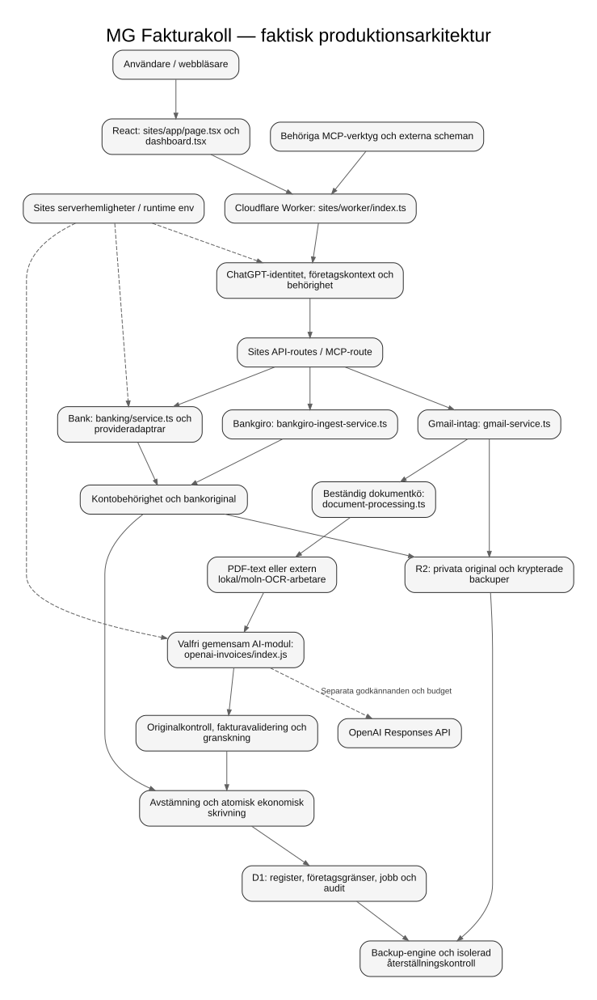

# MG Fakturakoll

## Starta MG Fakturakoll

```bash
npm start
```

Kör kommandot från repots rot. Appen öppnas på **http://localhost:3000** när terminalen visar `Redo:`. Node-servern innehåller frontend, API, lokal databas och schemalagda jobb; dokumentarbetare startas vid behov.

MG Fakturakoll samlar fakturor, originalunderlag och bankhändelser och hjälper dig att granska och stämma av dem. Systemet genomför inga bankbetalningar. Den lokala Node-appen och den publicerade Cloudflare/Sites-appen är två separata körmiljöer med olika databaser.

### Förutsättningar och första starten

Du behöver **Node.js 22.13 eller senare** och **npm 10 eller senare**, Git samt nätverksåtkomst för första beroendeinstallationen. Node 22 och 24 ingår i projektets CI. Docker behövs inte för normal lokal användning.

```bash
git clone https://github.com/sharbel0022/Mgeorge.git
cd Mgeorge
npm start
```

Startkommandot kontrollerar versioner och portar, installerar saknade lokala Node-beroenden från låsfilen och skapar en privat `.env` med slumpmässiga sessions- och krypteringsnycklar. Det kontrollerar faktisk HTTP-beredskap innan adressen markeras redo. En befintlig `.env` skrivs aldrig över. Befintlig databas utan sina nycklar stoppar starten: återställ ursprungliga nycklar, skapa inte nya.

Säkerhetskopiera `.env` privat. Den får aldrig läggas i Git. Gmail, OpenAI och bankanslutningar är valfria och behövs inte för lokal start. Avsluta med **Ctrl+C** eller `npm run stop` från samma checkout.

### De vanliga kommandona

| Kommando | Vad det gör |
| --- | --- |
| `npm start` | Förbereder och startar den lokala appen. |
| `npm run dev` | Samma start med bevakning och ordnad omstart av backend/delade moduler. |
| `npm run setup` | Skapar säker förstagångskonfiguration och installerar saknade lokala Node-beroenden. |
| `npm run doctor` | Diagnostiserar konfiguration, beroenden, databasplats, port och valfria anslutningar utan att ändra dem. |
| `npm run stop` | Stoppar endast processerna som denna checkouts autentiserade launcher äger. |
| `npm test` | Kör hela Node-testsviten. |
| `npm run build` | Installerar vid behov Sites byggberoenden och bygger den riktiga Sites-appen. |

[Detaljerad startguide och felhantering](docs/operations/local-start.md).

## Valfri konfiguration och OpenAI

`.env.example` dokumenterar serverinställningarna. `npm start` läser `.env`; värden i processmiljön har företräde. Standarddatabasen är `./data/mgeorge.sqlite`. För annan port anger du både `PORT` och motsvarande `APP_ORIGIN`.

```dotenv
OPENAI_API_KEY=
OPENAI_MODEL=
OPENAI_FALLBACK_MODEL=
OPENAI_ENABLED=false
OPENAI_MAX_OUTPUT_TOKENS=2000
OPENAI_TIMEOUT_MS=30000
OPENAI_DAILY_BUDGET_USD=2
OPENAI_MONTHLY_BUDGET_USD=50
```

AI är avstängt från början. Saknad nyckel, saknad modell eller ogiltig konfiguration hindrar inte appstarten: **OpenAI är inte konfigurerat. Befintlig OCR används.** Modellvalet kommer från `OPENAI_MODEL`; kapacitet och konservativa priser måste finnas i ett granskat modellkontrakt. Ett nytt modellnamn utan känt priskontrakt får inte kringgå budgetkontrollen.

Innan original får skickas krävs dessutom dokumenterade sekretess-, säkerhets- och kostnadsgodkännanden, en beslutsreferens och uttrycklig företagsbindning. Dagliga och månatliga budgetreservationer lagras beständigt. Reservmodell är valfri och får egna kontroller och kostnadsreservationer. AI-förslag blir aldrig bankverifierade betalningsbevis.

Administratörer kan läsa **OpenAI-status** under inställningar. Statusen skiljer konfiguration från faktisk företagspolicy och intygar inte verklig modellåtkomst eller fakturering. API-nyckeln skickas aldrig till webbläsaren. [Fullständig AI-guide med godkännanden och modellkontrakt](docs/integrations/openai.md).

## Hitta i koden

| Del | Offentlig ingång / verklig körväg |
| --- | --- |
| Lokal start | `scripts/start/index.mjs` → `apps/api/index.js` → `src/server.js` |
| Lokal frontend | `public/index.html`, `public/app.js` och tillhörande vyfiler |
| Sites frontend | `sites/app/page.tsx`, `sites/app/dashboard.tsx`, `sites/components/` |
| Sites Worker och API | `sites/worker/index.ts`, `sites/app/api/` |
| AI för båda miljöerna | `packages/ai/index.js` → `sites/lib/openai-invoices/index.js` |
| Övriga domäner | `packages/<domän>/index.js`; se modulregistret nedan |
| Node dokumentarbetare | `src/invoice-worker.js`, startad genom `packages/ocr/index.js` |
| Sites dokumentkö och extern OCR | `sites/lib/document-processing.ts`, `scripts/run-sites-cloud-ocr.mjs` |
| Lagring | Node: SQLite per företag. Sites: D1 och privata R2-original. |

[Modulregister med ansvar och implementation](packages/README.md) · [Arkitekturens 14 orienteringsfrågor](docs/architecture/ARCHITECTURE.md) · [Dataflöde](docs/architecture/data-flow.md).



[Redigerbar Mermaid](docs/architecture/architecture.mmd) · [Separat lokalt diagram](docs/architecture/local.mmd) · [Diagramguide](docs/architecture/README.md).

## Tester och utvecklingskontroller

Den fulla verifieringen omfattar Node 22 och 24, Sites, Bankgiro-bryggan, behörigheter, ekonomiska spärrar, AI/OCR-återhämtning, verkliga SQLite-/D1-vägar, Chromium och syntetiska företag. Kör kvalitetprofilerna från root för maskinläsbara kvitton med källversion, testresultat, audit och loggar:

```bash
npm run quality:node
npm run quality:sites
npm run quality:bridge
npm run quality:performance
npm run quality:browser
```

Profilerna installerar sina låsta beroenden. Kör dem i ordning i samma checkout; en installation får inte ersätta beroenden som en annan pågående svit använder. `--skip-install` är endast avsett för en redan förberedd checkout. Node-testsviten använder även delade Sites-bibliotek; för en full utvecklingsmiljö krävs därför Sites beroenden även när enbart Node-sviten ska köras. `npm run build` förbereder dessa, eller kör Sites dokumenterade `npm run install:ci`.

[Aktuell acceptansrapport och exakta verifieringskvitton](docs/cleanup/ACCEPTANCE.md). Historiska testresultat är inte bevis för en senare kodversion.

## Produktion

GitHub `main` är den samlade kodkällan. Publicerad Sites använder projektet `appgprj_6adf2f7f7e848191b64192161886b528`, dess egna identitetskontroller, D1, R2 och serverhemligheter. Den lokala `.env` kopieras aldrig till produktion och lokal SQLite synkroniseras inte automatiskt med D1.

En normal merge publicerar inte automatiskt en Sites-version. Publicering kräver verifierad källversion, bygge, bibehållna resursbindningar och läsande efterkontroller. Bankens samtycke, Bankgirokälla, Gmail-schemakadens och godkänd live-AI har separata acceptanskrav. En grön kodsvit eller lyckad deployment upphäver inga sådana spärrar.

Se [produktionsarkitektur](docs/architecture/ARCHITECTURE.md), [befintliga driftguider](docs/operations/) och [aktuell leveransstatus](docs/cleanup/ACCEPTANCE.md).

## Felsökning

Börja med `npm run doctor`. Vid upptagen port: stoppa din tidigare projektstart med `npm run stop` eller välj en annan port i `.env`. Launchern dödar aldrig en okänd portägare. Vid saknade nycklar till en befintlig databas: återställ den privata originalkonfigurationen. Vid installationsfel: kontrollera npm-version, nätverk och paketkällor och kör därefter `npm start` igen.

[Startguiden](docs/operations/local-start.md) förklarar kontrollkanal, omstart, databasskydd, valfria integrationer och plattformsgränser. [KODGUIDE](docs/KODGUIDE.md) och befintliga säkerhets-/releaserapporter finns kvar. [Tidigare README](docs/history/README-before-cleanup-2026-11-07.md) bevaras uttryckligen som historik och ska inte användas som aktuellt startrecept.
