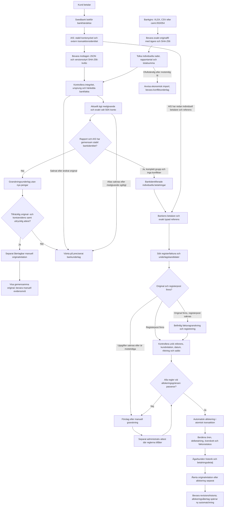
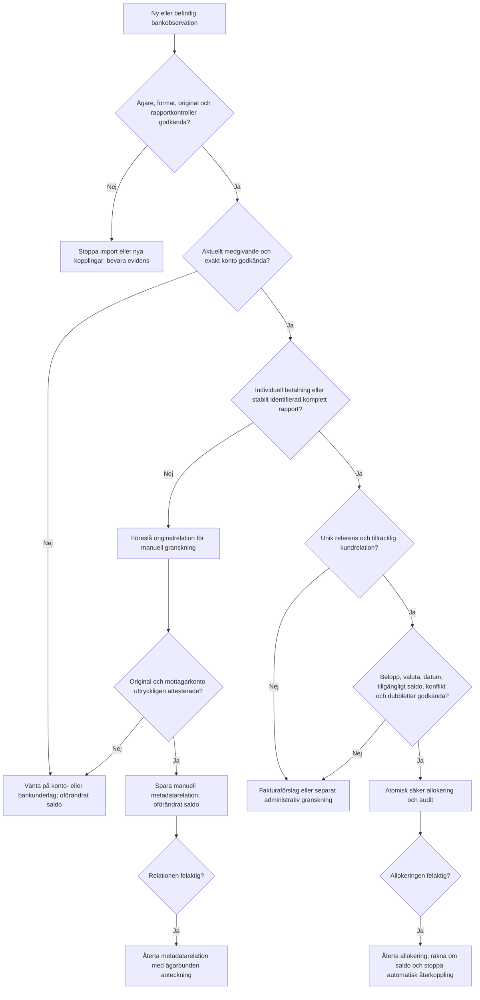
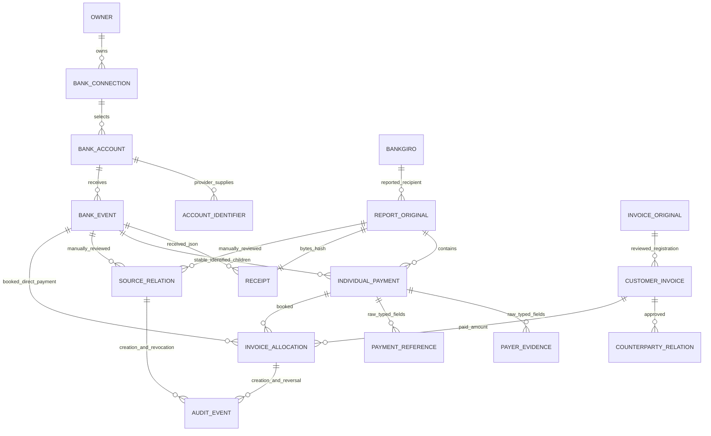
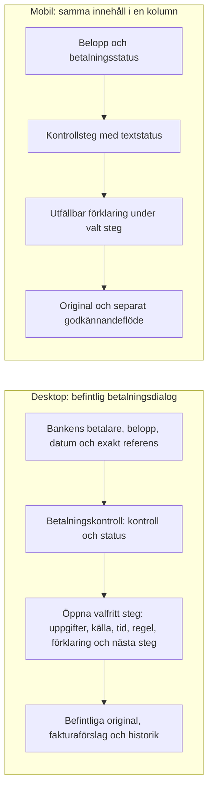

# MGEORGE – hela betalningskedjan

Datum: 2026-11-01. Arkitekturen beskriver befintliga Node- och Sites-motorer och denna cykels kontroller. Faktiska test- och driftresultat finns i [verifieringsrapporten](END-TO-END-PAYMENT-VERIFICATION.md). Original, personuppgifter, kontonummer och originalens kontrollsummor bevaras privat.

## Flöde och felvägar

En AIS-post med individuella bankuppgifter behöver inte invänta en separat Bankgirofil. En samlingspost får däremot inte bli en individuell betalning genom en beloppslikhet eller ett fakturaförslag. Den manuella originalrelationen i diagrammet har ingen pil till automatisk allokering: den är endast ett granskningsbeslut om underlag.

## Beslut och ekonomiska konsekvenser

| Beslut | Tillåten effekt |
| --- | --- |
| Faktura- eller underlagsförslag | Ingen saldoförändring och ingen ny ekonomisk post |
| Manuell underlagsrelation | Separat metadata, anteckning, tidpunkt och återtag; ingen fakturabetalning |
| Automatisk allokering | Endast efter befintlig original-, konto-, identitets- och matchningsgräns |
| Administrativ fakturaattest | Separat uttryckligt beslut, verifierbart bankoriginal och aktuellt konto; inte bankverifierad betalaridentitet |
| Saknat underlag efter tidigare bokning | Visa verifieringsbrist och stoppa nya beslut; bevara redan bokade belopp |
| Återtag | Ny historikhändelse; ändra inte originalfakta och skriv inte om tidigare beslut |

## Datamodell och evidensnivåer

Bankgiro-till-kontorelation i modellen är ett krav på bankevidens, **inte en ny fristående verifierad mappningstabell**. Sites löser endast exakta identifierare i det valda kontots banklevererade resurs. Node kräver exakt IBAN. Saknat alias får inte fyllas med en fri manuell sifferöversättning. Bankgironumret i rapporten är en originalobservation och bevisar inte ensamt mottagarkontorelationen.

| Evidensnivå | Node | Sites | Vad den bevisar |
| --- | --- | --- | --- |
| Bankoriginal | `import_jobs.content`, banktransaktionens `raw_bank_data` | Ägda dokument i R2, `bankData` och bevarade detaljoriginal | Mottagna bytes/JSON-representation och ursprung; SHA är integritetskontroll, ingen fristående bankunderskrift |
| Ankomstkvitto | `content_sha256`, `raw_bank_data_sha256`, identitetsversion | Dokumenthash, `bankDataSha256`, `bankDataVersion` | Oförändrad bevarad representation enligt aktuell profil; historisk backfill bevisar inte äldre ankomst |
| Bankkonto | Krypterad `bank_connections.accounts_json`, valt UID, ägare, status och giltighet | Ägd anslutning/applikationsgeneration, production, giltighet, valda konton och bankresurs | Aktuellt tillåtet mottagarkonto; separat från ett originals integritet |
| Härledning | Omtolkade parserfält och `reconciliationData` | `original`, `payerEvidence`, `referenceEvidence`, analys/preview | Spårbar tolkning; bankens råvärden och ledande nollor bevaras |
| Manuellt beslut | `bank_specification_links`, `payer_links`, administrativ allokering | `bankgiroLinks`, separat `verification`, manuell allokering | Vem som granskade vad; får inte omklassificeras till bankens identitet |
| Ekonomiskt bokat | `bank_transactions`, `allocations` | Ekonomiska transaktioner och aktiva `allocations` i workspace | Faktisk öresallokering; reviewrapporter och originalrelationer är inte extra pengar |
| Revision | SQLite-transaktion och audit | Workspace-revision/CAS, request-kvitto, ägarfiltrerad audit | Atomik, samtidighet, återtag och förklarbar historik |

Sites `writePaymentState` jämför en färsk exakt medgivandesnapshot inne i samma D1-batch som audit och workspace-CAS när nya allokeringar eller rapportpromotion ska sparas. En ändrad anslutning, valt konto, krypterad kontoresurs/session, ägare, miljö, applikationsgeneration, bank/land eller utgången giltighet stoppar hela batchen. Frånkoppling kan därför inte passera mellan en tidigare godkänd originalkontroll och ekonomisk commit. Befintligt schema används; inget nytt produktionsregister skapas.

## Implementationskarta

| Led | Node | Sites |
| --- | --- | --- |
| AIS och kontoval | `src/bank.js`, bankrutter i `src/server.js` | `lib/banking/service.ts`, `transactions.ts`, `details-service.ts` |
| CSV/XML/XLSX | `src/importers.js`, gemensamma parserfiler | `lib/imports.ts`, `bankgiro-parser.js`, `bankgiro-xlsx.js` |
| Original, kvitto och allokeringsgräns | `src/reconciliation.js`, `src/bank-evidence.js` | `lib/bank-api-original.js`, `reconciliation-evidence.ts`, `bankgiro-service.ts` |
| Manuell originalrelation | `src/bankgiro-links.js` | `lib/domain.ts`, `bankgiro-service.ts`, `components/bankgiro-link-review.tsx` |
| Fakturaunderlag och registrering | `src/invoice-review.js`, Gmail/OCR-flöden | `lib/document-processing.ts`, Gmail/OCR-flöden |
| Kund och fakturareferens | `src/reconciliation.js`, `payment-references.js` | `lib/reconciliation.ts`, `reconciliation-engine.js`, `payment-references.js` |
| Allokering och saldo | `src/db.js`, `src/reconciliation.js` | `lib/domain.ts`, `lib/reconciliation.ts` |
| Läsande betalningskontroll | Befintlig översikt och separat original-/kontostatus i API | `GET /api/bank/verification`, `lib/payment-verification.ts`, `components/payment-verification.tsx` |

Node är den befintliga administratörsstyrda en-företagsarbetsytan. Sites isolerar arbetsyta, original, bankresurser och audit per ChatGPT-ägare. De har olika lagring, men samma säkerhetsprinciper. Ingen parallell ekonomimotor eller separat produktionsdatabas har införts.

## Gränssnitt: desktop och mobil

Den nya Sites-detaljen öppnas från befintlig bankrad. Den globala knappen som kör Gmail/dokument/bank/avstämning är en annan funktion; att öppna en betalningskontroll startar inget av dessa jobb.

Svart och vitt, tydliga textstatusar, tangentbordsåtkomliga utfällningar och radbrytning för långa värden. Gränssnittet skiljer på bankfakta, manuella beslut, förslag och bokförda belopp. Fakturakund ersätter aldrig bankens betalarnamn. Ett registerfynd utan kontrollerat fakturaoriginal visas med den begränsningen. Tidpunkten avser den läsande kontrollen och får inte kallas bankens attesttid.

## Externa gränser

625-kronorsfallet är inte färdigavstämt. Aktuellt kontoalias för rapportformatet, bankens uttryckliga rapport-/AIS-samband samt separat fakturaregistrering/motpartsgranskning återstår. Företagets formella OCR-avtal och rapportkanal är inte verifierade genom generella parserregler. Det är korrekt att lämna betalningen i granskning tills dessa krav har styrkts.
