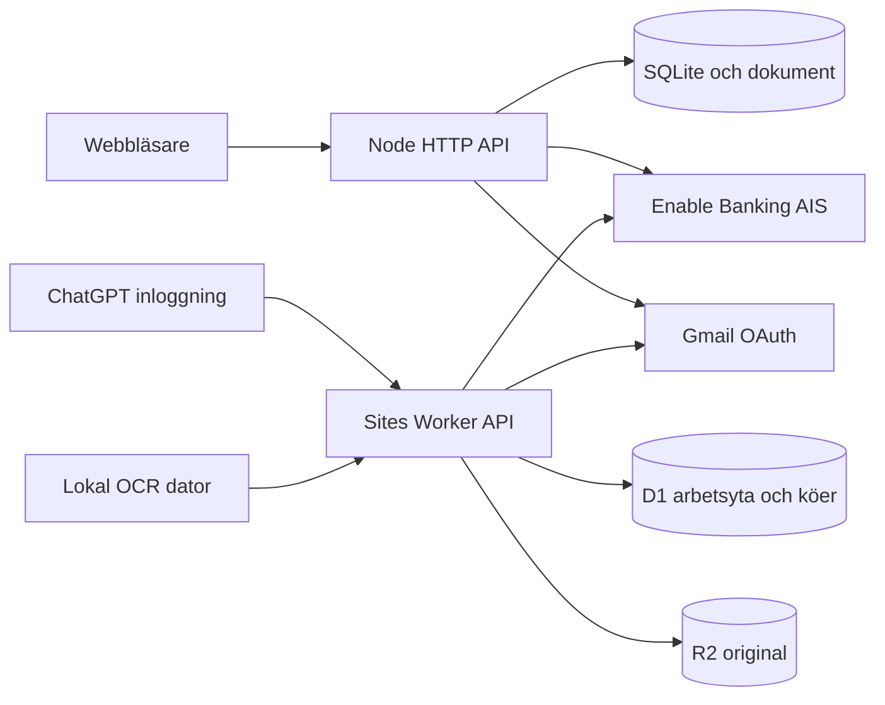
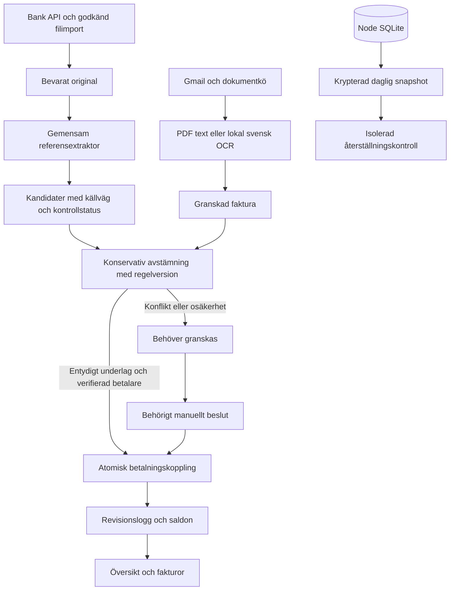
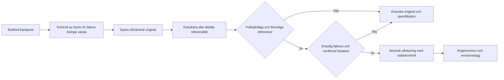
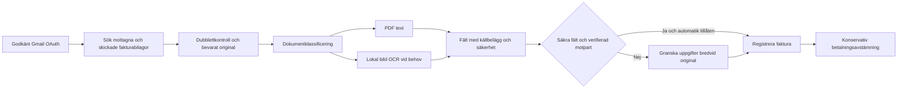
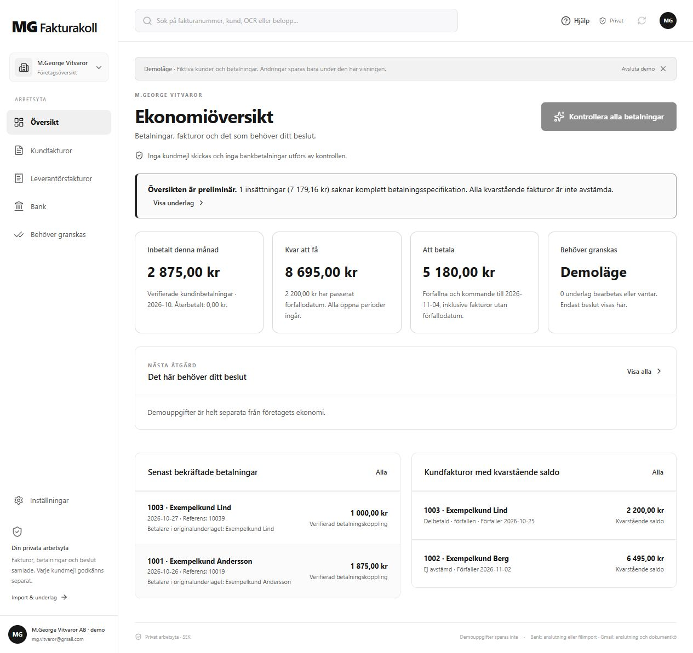
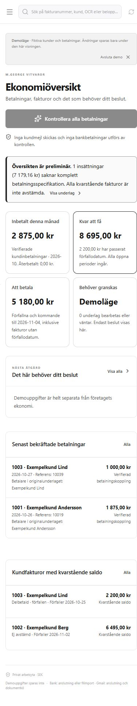
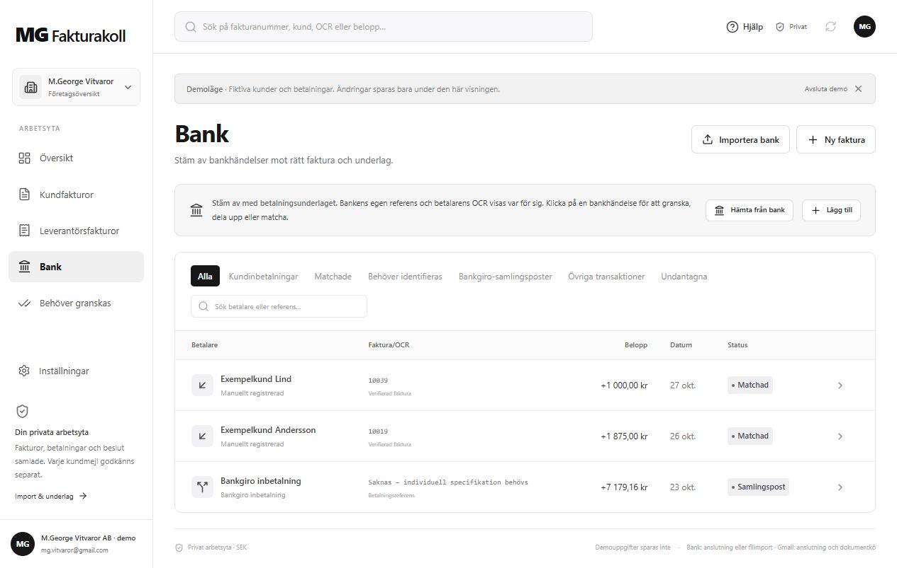
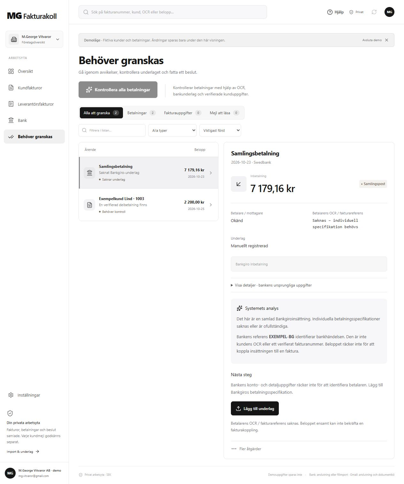

# Mgeorge V2 arkitektur och gränssnitt

Diagrammen visar kodens faktiska installationsgränser. Node och Sites är separata körmiljöer med separata register. UI-bilderna visar fiktiva uppgifter i den levererade appen.

## Arkitekturen vid arbetets början

Node implementeras av `src/server.js`, `src/db.js`, `src/bank.js` och `src/gmail.js`. Sites använder `sites/worker/index.ts`, API-rutterna, `sites/lib/server.ts` och bank-/Gmail-modulerna. Inga fakturauppgifter flyttas mellan installationerna av Git-publiceringen.

## Levererad systemarkitektur

Referenser hanteras av `src/payment-references.js` och samma kod i `sites/lib/payment-references.js`. Avstämningen ligger i `src/reconciliation.js`, `sites/lib/reconciliation-engine.js` och `sites/lib/reconciliation.ts`. Lagringens transaktionskontroller finns i `src/db.js`, `sites/lib/domain.ts` och `sites/app/api/state/route.ts`. Node-backupen ligger i `src/backup.js`; D1/R2 har en separat driftgräns.

## Från banktransaktion till faktura

API-normalisering sker i `sites/lib/banking/transactions.ts` och `src/importers.js`. Detaljsökningen i `sites/lib/banking/details-service.ts` kontrollerar den valda bankposten och sparar detaljoriginal i R2. Referensernas källvägar visas i transaktionsdetaljen i `sites/app/dashboard.tsx`. Ett detaljsvar delar inte automatiskt upp en samlingspost.

## Från Gmail till registrerad faktura

Node använder `src/gmail.js`, `src/invoice-extraction.js`, `src/invoice-review.js` och `src/invoice-worker.js`. Sites använder `sites/lib/gmail-service.ts`, `sites/lib/document-processing.ts`, `sites/lib/invoice-fields.js` och lokal OCR-kö. Konflikter mellan text, filnamn och mejlrubrik blockerar automatisk fakturaregistrering.

## Desktopöversikt

`sites/components/economy-overview.tsx` visar saldon från `sites/lib/economy-summary.js` och beslut från betalningskontrollen. En uttrycklig preliminärmarkering synliggör saknat underlag. `sites/app/dashboard.tsx` ger fem huvudområden och separat inställningsval.

## Mobilöversikt

Samma komponenter använder responsiva regler i `sites/app/globals.css`. Sidomenyn blir en öppningsbar mobilmeny och sammanfattningarna anpassas till smal skärm.

## Banktransaktioner

Banklistan i `sites/app/dashboard.tsx` visar betalare, OCR/fakturareferens, belopp, datum och status. Matchade betalningar och samlingsposter visas separat; samlingspostens bankreferens presenteras inte som kundens OCR.

## Granskning av osäker betalning

`sites/components/payment-control.tsx` visar granskningslistan bredvid valt underlag. `TransactionDetail` i `sites/app/dashboard.tsx` visar bankoriginal, referenskällor och nödvändig komplettering. En samlingspost utan individuell specifikation har ingen automatisk fakturamatchning.
