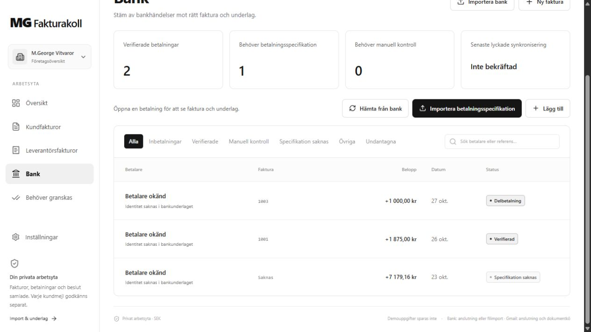
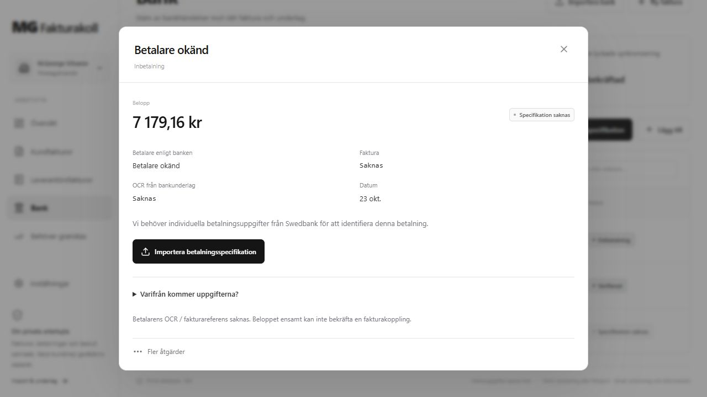
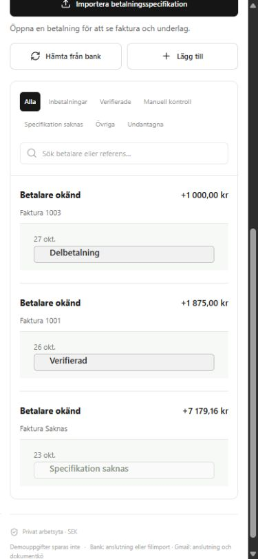
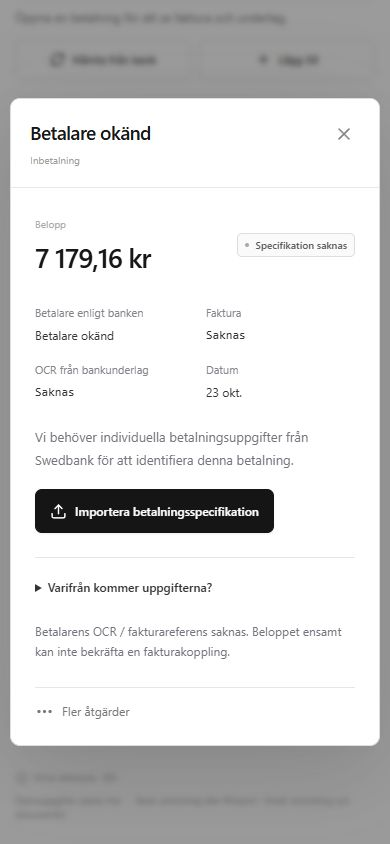

# Mgeorge V3 – bankunderlag och moln-OCR

Leveransen bygger på `main` (`73e0777`) i branchen `codex/mgeorge-v3-cloud-ocr`. UI-förtydligandena i befintlig PR #9 har beaktats och ingår i den nya sammanhållna bankvyn. Produktionssystemets version 28 och dess företagsdata har inte ändrats.

## Vad användaren får

Banklistan visar betalare, faktura, belopp, datum och status. Bankens betalare hämtas från bankunderlaget; ett manuellt tillagt kundnamn eller ett fakturaförslag blir aldrig bankidentitet. Saknad identitet visas som **Betalare okänd**. Kort ersätter tabellen på mobil. Fyra sammanfattningar visar verifierade betalningar, saknade specifikationer, manuell kontroll och senaste lyckade synkronisering.

Detaljvyn prioriterar betalare, belopp, faktura, faktiskt bank-OCR, datum och status. **Varifrån kommer uppgifterna?** innehåller fakturakund, manuella kompletteringar, bank-/fakturakällor och kontrollresultat. Tekniska originalfält ligger i utfällbara sektioner. En saknad specifikation får primäråtgärden **Importera betalningsspecifikation**.

Bankimporten använder samma begränsade namnrymdsmedvetna camt-parser i förhandsgranskning och vid återläsning av sparat original. Den bevarar individuella uppgifter och separata referenskällor, kontrollerar originalets hash samt konto, datum, identifierare, antal och totalsumma för grupper. Fullständiga väntande grupper kan kopplas automatiskt när rätt samlingspost anländer. En borttagen, undantagen eller möjlig dubblettrad får inte lämna en falskt komplett grupp. Äldre väntande grupper som saknar lagrat originalantal och originaltotal kräver återimport från originalet. Ingen omtolkning av ett belopp till kundidentitet införs.

Moln-OCR använder samma svenska Tesseract, granskningsregler och beständiga dokumentkö som den lokala OCR-datorn. Efter aktivering kör GitHub Actions normalt var femtonde minut på en tillfällig Ubuntu-maskin. Molnet försöker först text-PDF:er i Sites och behandlar därefter högst sex skannade dokument. Separata hemligheter och ett gemensamt atomiskt jobblås skyddar lokal och molnbaserad OCR från dubbla resultat. Status skiljer konfiguration, senaste kontakt och senast sparat OCR-resultat. OCR skapar inte bankverifiering och osäkra fält kräver fortsatt granskning.

## Verifiering

**251 Node-tester och 326 Sites-tester passerar.** Node-syntaxkontroll (53 JavaScript-filer), TypeScript och produktionsbygge är godkända. Båda beroendegranskningarna rapporterar **0 kända sårbarheter**. Ramverkets bygge ger befintliga varningar om sourcemaps och dynamiska importer, men avslutas utan fel. Testdata är syntetiska; produktionsfakturor och bankbetalningar har inte använts som destruktiva testdata.

- Node: syntaxkontroll, full testsvit och beroendegranskning.
- Sites: TypeScript, full testsvit, produktionsbygge och beroendegranskning.
- Sammanhängande OCR-test: faktisk pull-klient → Sites jobb-API → privat lagringsfixture → svensk Tesseract → sparad tolkning, utan lokal OCR-kontakt. Originalet bevaras, faktura `0606` och `375000` öre läses och resultatet kräver granskning.
- Bankregressioner: masterpromptens 15 scenarier, ägarisolering, samtidiga importer, källspårning, delbetalningar, motstridiga referenser och ofullständiga grupper. Se [scenariomatrisen](V3-BANK-EVIDENCE.md).
- Webbläsarkontroll: isolerat demoläge på lokal testserver; desktoplista, mobilkort, detaljvy, utfällbar källspårning och importåtgärd. Vid 390 pixlars mobilbredd var dokumentets scrollbredd lika med klientbredden i både listan och detaljvyn. Skärmbilderna nedan visar enbart fiktiva uppgifter. Demots manuellt registrerade betalningar kan ha bekräftad fakturakoppling samtidigt som bankidentitet saknas; de visas därför som Betalare okänd.

## Skärmbilder

## Produktionsstatus och kvarvarande kontroller

Ingen merge, Sites-publicering, ny hemlighet eller aktivering av moln-OCR har utförts i denna leverans. Den additiva migrationen `0010_silent_boomerang.sql` tillför endast OCR-status och körningsidentitet. Befintliga fakturor, bankposter, allokeringar, original, anslutningar och krypteringsnycklar bevaras. Backupmotor och befintliga bankers scheman byts inte ut.

Read-only-kontrollen av Sites den 28 oktober 2026 visade bank- och backupschemat aktiva, men **det befintliga Gmail-timschemat pausat**. Den senaste verifierade molnbackupen hade 37 av 37 original. Runtimeflaggan för Gmail-schema är konfigurationsmetadata och bevisar inte att plattformens schema är påslaget.

Efter godkänd granskning behövs följande konkreta steg för att löftet om drift med avstängd dator ska gälla i produktion:

1. Publicera den testade Sites-versionen med migrationen i samma befintliga Site.
2. Lägg in en separat `DOCUMENT_CLOUD_WORKER_TOKEN` i Sites och samma token som `MG_SITES_OCR_TOKEN` i GitHub Actions. Ange Sites-origin och aktiveringsflaggorna enligt [moln-OCR-guiden](V3-CLOUD-OCR-RUNNER.md).
3. Kör molnjobbet med ett syntetiskt original medan den lokala OCR-körningen är stoppad; kontrollera sparat resultat, granskningsstatus, original och kö.
4. Återaktivera det befintliga Gmail-timschemat och bekräfta ny lyckad hämtning. Behåll bankens väntetid och backupjobbet; skapa inga dubbla scheman.
5. Verifiera en aktuell anonymiserad Swedbank-specifikation och företagets OCR-avtal. Automatisk hämtning av bankens individuella rapporter kräver bekräftad avtalad kanal; fram till dess finns filimporten.

GitHub-schemat kan fördröjas och inaktiveras vid lång inaktivitet i ett publikt repository. Faktisk GitHub-drift och full produktionsdrift med avstängd dator är ännu inte verifierade. Exakt bank-MIG, OCR-längdregel och Bg Max-import är inte verifierade; Bg Max har ingen parser. [Bankguiden](V3-BANK-EVIDENCE.md) och [OCR-guiden](V3-CLOUD-OCR-RUNNER.md) beskriver begränsningarna och deras officiella källor.

## Ändrade filer

- `.github/workflows/payment-control-ci.yml`
- `.github/workflows/sites-cloud-ocr.yml`
- `README.md`
- `docs/V3-BANK-EVIDENCE.md`
- `docs/V3-CLOUD-OCR-RUNNER.md`
- `docs/V3-DELIVERY.md`
- `docs/screenshots/v3/bank-desktop.jpg`
- `docs/screenshots/v3/bank-mobile.jpg`
- `docs/screenshots/v3/payment-detail-desktop.jpg`
- `docs/screenshots/v3/payment-detail-mobile.jpg`
- `scripts/run-sites-cloud-ocr.mjs`
- `sites/app/dashboard.tsx`
- `sites/app/globals.css`
- `sites/components/bank-payments.tsx`
- `sites/components/document-ocr-status.tsx`
- `sites/components/gmail-workspace.tsx`
- `sites/components/payment-control.tsx`
- `sites/db/schema.ts`
- `sites/drizzle/0010_silent_boomerang.sql`
- `sites/drizzle/meta/0010_snapshot.json`
- `sites/drizzle/meta/_journal.json`
- `sites/lib/bankgiro-parser.js`
- `sites/lib/bankgiro-service.ts`
- `sites/lib/banking/mcp.ts`
- `sites/lib/customer-messages.ts`
- `sites/lib/document-processing.ts`
- `sites/lib/domain.ts`
- `sites/lib/imports.ts`
- `sites/lib/payment-control.ts`
- `sites/lib/payment-overview.ts`
- `sites/lib/payment-presentation.ts`
- `sites/lib/payment-references.js`
- `sites/lib/reconciliation-engine.js`
- `sites/lib/reconciliation.ts`
- `sites/tests/bank-payment-ui.test.mjs`
- `sites/tests/bankgiro-api.test.mjs`
- `sites/tests/bankgiro.test.mjs`
- `sites/tests/cloud-ocr.test.mjs`
- `sites/tests/customer-messages.test.mjs`
- `sites/tests/domain.test.mjs`
- `sites/tests/economy.test.mjs`
- `sites/tests/gmail.test.mjs`
- `sites/tests/payment-control-ui.test.mjs`
- `sites/tests/payment-references.test.mjs`
- `src/payment-references.js`
- `src/reconciliation.js`
- `src/sites-ocr-pull.js`
- `test/payment-references.test.js`
- `test/sites-ocr-pull.test.js`
