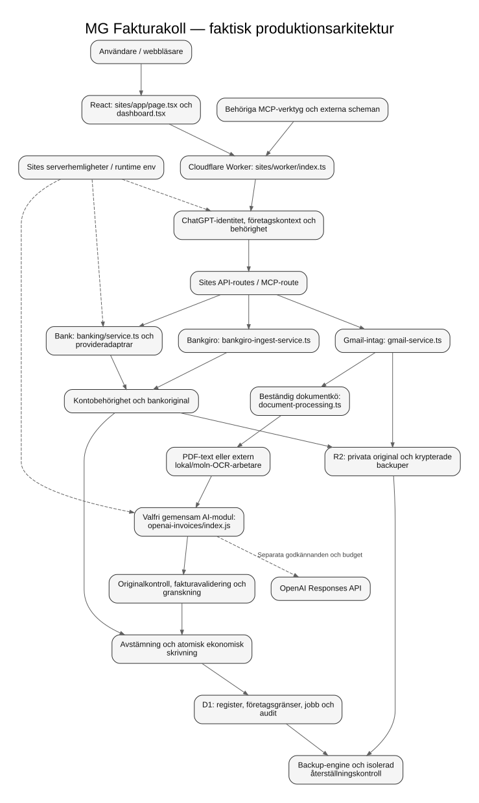

# MG Fakturakolls faktiska arkitektur

## Två körmiljöer, gemensamma regler

Den lokala appen är en Node-process som serverar statiska HTML/CSS/JavaScript-filer, HTTP-API, SQLite och schemalagda jobb. CPU-krävande PDF-/bildtolkning sker i separata arbetare. Den publicerade appen använder React/Vinext och Cloudflare Workers, med D1 för register och R2 för original. Sites-arbetaren kan köa optisk tolkning till den befintliga externa Node-arbetaren.

Lokalt och i produktion finns samma domäner men olika runtimeadaptrar. De utbyter inte databaser automatiskt. En lokal start hämtar inte produktionsdata. En GitHub-push publicerar inte en Site.

### Produktion

Redigerbar källa: [architecture.mmd](architecture.mmd). Lokal variant: [local.mmd](local.mmd).

## 1. Var börjar applikationen?

Lokalt är användarens ingång `npm start`. Rotens `package.json` anropar startskriptet under `scripts/start/`, som gör kontroller och säker förstagångsinstallation. Den kör sedan `apps/api/index.js`. `npm run dev` använder samma kontrollkedja med omstart vid kodändring.

I produktion börjar varje HTTP-anrop i `sites/worker/index.ts`. Den etablerar requestbunden connector- och företagskontext och skickar anropet till Vinexts fetch-handler. Det finns ingen långlivad Node-server i Sites-miljön.

## 2. Vilken fil startar backend?

`apps/api/index.js` är den tydliga lokala köringången; den importerar `src/server.js`. Den senare komponerar HTTP-router, sessioner, företagsruntime, domäntjänster, schema och verklig HTTP-lyssnare. Det äldre direkta anropet till `src/server.js` behålls för kompatibilitet och befintliga tester.

Sites backend är `sites/worker/index.ts` plus `sites/app/api/**/route.ts` och `sites/app/mcp/route.ts`. Routefilerna använder serviceingångar under `sites/lib/`.

## 3. Vilken fil startar frontend?

Lokalt skickar samma backend `public/index.html`, som laddar `public/app.js` och befintlig CSS. Det behövs ingen separat Vite-process för Node-gränssnittet.

Sites börjar med `sites/app/layout.tsx` och `sites/app/page.tsx`; hemsidan använder `sites/app/dashboard.tsx`. Vinext bygger klientdelarna och serverrenderingen genom `sites/vite.config.ts`. Det svartvita gränssnittet och navigationen bevaras.

## 4. Vilken worker behandlar dokument?

Node: `src/invoice-extraction.js` samordnar arbetet och startar `src/invoice-worker.js`. PDF.js läser text och kan rendera PDF-sidor; Canvas och Tesseract gör optisk tolkning. Arbetaren får begränsade indata och körs utanför HTTP-processen. `packages/ocr/index.js` är den offentliga Node-ingången.

Sites: `sites/lib/document-processing.ts` hanterar beständig kö, behörighet, lease, retries, resultatkvitton och registreringsgrindar. `sites/app/api/ocr-worker/[action]/route.ts` är den skyddade transporten. Den externa OCR-processen startas av `scripts/run-sites-cloud-ocr.mjs` och återanvänder `src/sites-ocr-pull.js` och den lokala dokumentarbetaren. GitHub-workflowen och externa scheman är separata från Workers HTTP-körning. Att en kö är konfigurerad bevisar inte att schemat verkligen kör.

## 5. Var konfigureras OpenAI?

Den lokala servern läser `.env` och processmiljön. Sites använder serverns runtimehemligheter och miljövärden. `.env.example` är en dokumenterad mall, aldrig ett produktionspaket. AI-modulens konfiguration och publika status ligger under `sites/lib/openai-invoices/` och exporteras för Node via `packages/ai/index.js`.

`OPENAI_MODEL` väljer modell; `OPENAI_ENABLED` styr aktivering. Output-tokenbudget, tidsgräns, dags- och månadsbudget samt eventuell reservmodell kontrolleras i samma modul. Den fullständiga variabellistan, pris-/kapabilitetskraven och bakåtkompatibiliteten finns i [OpenAI-guiden](../integrations/openai.md).

Att ange en modell och nyckel ger inte tillåtelse att skicka kunddokument. Befintliga sekretess-, säkerhets- och kostnadsgodkännanden, spårbart godkännande-ID, tillåtna företag och betrodd företagsidentitet gäller fortfarande. Konfigurationens status innehåller inga nycklar och påstår inte att projektets modellåtkomst har verifierats.

## 6. Vilken fil anropar OpenAI?

`sites/lib/openai-invoices/adapter.js` är den gemensamma Responses-adaptern. Node och Workers ska inte skapa egna parallella provideranrop. `src/openai-invoice-integration.js` är den tunna Node-adaptern; `sites/lib/openai-invoices/sites.js` är Workers-adaptern. De kontrollerar runtimeberoende databaser, dokumenthashar, rätt företag och aktuella leases.

Schema, instruktioner, profiler/konfiguration, kostnadsberäkning, auditjournal, källbelägg och återställningsspärrar har separata interna filer. Konsumenterna använder den stabila offentliga ingången. Det är en gemensam modul med flera begripliga filer, ingen stor fil som blandar alla ansvar.

Vid avstängd, saknad eller felaktig konfiguration fortsätter befintlig OCR. Nätverks- eller modellfel får inte skapa ett påhittat resultat. Alla AI-förslag kräver granskning och har `bankEvidence=false`; ingen betalning eller bankverifiering skapas av modellen.

## 7. Hur kommer Gmail-data in?

Node använder `packages/gmail/index.js` → `src/gmail.js`. Servern binder OAuth-state och session, verifierar det avsedda kontot och lagrar tokens krypterat. Hämtning bevarar dokumentoriginal och deras källkopplingar. `src/integration-jobs.js` och företagsruntime begränsar samtidiga jobb och håller rätt databas aktiv.

Sites använder `sites/app/api/gmail/[action]/route.ts` → `sites/lib/gmail-service.ts`. Medgivande, ägare, företagskontext, begränsade bilagor, deduplicering och retry-tider kontrolleras före dataskrivning. Originalet hamnar i R2, metadata och köstatus i D1. Därefter arbetar `document-processing.ts`. Externa scheman anropar den behöriga tjänsten; de får inte ersättas med ett historiskt hämtningskvitto.

## 8. Hur kommer Bankgiro-information in?

Manuella CSV-/camt-/XLSX-underlag och provider-/rapportintag har egna validerade vägar. Node-ingången är `packages/bankgiro/index.js`. Sites använder `sites/lib/bankgiro-service.ts` för granskning och `sites/lib/bankgiro-ingest-service.ts` för den beständiga rapportkön.

`sites/lib/bankgiro-source-registry.js` väljer endast konfigurerad källa med korrekt företags-/kontobindning. Den valfria SFTP-bryggan i `bridge/bankgiro/` kör separat Node, eftersom Workers transportmiljö skiljer sig. Den behöver verifierad servernyckel, rätt rapportbehörighet och egna skyddade hemligheter. En saknad källa visas som `SOURCE_NOT_CONFIGURED`.

Rapportoriginal, SHA-256, mottagarkonto, rapportidentifierare, totalsumma och referensproveniens valideras. Ledande nollor bevaras. En samlingsrapport tillför detaljer till en befintlig ekonomisk insättning; den ska inte bokas som en extra inbetalning.

## 9. Hur matchas fakturor med betalningar?

`packages/reconciliation/index.js` samlar Node-reglerna. Sites använder `sites/lib/reconciliation.ts`, gemensamma rena regler i `reconciliation-engine.js`/`reconciliation-contract.js`, samt runtimeberoende original- och skrivkontroller.

Avstämning använder rätt företag, konto, bankoriginal, aktuell behörighet, belopp, uttrycklig referens och tillräcklig motpartsidentitet. Liknande belopp eller AI:s tolkning räcker inte. Förhandsgranskning är läsande. En finansiell allokering kräver de befintliga atomiska kontrollerna, återkontrollerad behörighet och audit.

Delbetalningar, överskott, återbetalningar, samlingsinsättningar och motstridiga bevis behåller sina särskilda regler. Tidigare saldon skrivs inte om för att ett senare bevis saknas; presentationslagret visar skillnaden mellan registrerad historik och aktuell verifiering.

## 10. Var lagras uppgifter?

| Uppgift | Lokal Node | Sites produktion |
|---|---|---|
| Företagskatalog och aktiv kontext | SQLite-kontrollkatalog | D1:s företags-/medlemskapstabeller |
| Fakturor, bankhändelser och allokeringar | Separata SQLite-databaser per företag | Ägar-/företagsavgränsade D1-tabeller |
| Dokumentoriginal och bankbevis | SQLite-BLOB och hash/proveniens | Privata R2-objekt med metadata/hash i D1 |
| OAuth-/providertokens | Krypterade serverposter | Runtimehemligheter och skyddade krypterade poster |
| Jobb, retry, idempotens och audit | Beständiga SQLite-poster | Beständiga D1-poster och atomiska guards |
| Krypterade backuper | Explicit konfigurerad privat katalog | R2 via befintlig backupmotor |

`src/db.js` utför Node-schemaarbete och ekonomiska transaktioner. Sites databasåtkomst och requestgräns samordnas i `sites/lib/server.ts`; företagsisoleringen ligger i `sites/lib/company-storage.js`. Versionsstyrda migreringar och återställningsgrindar behålls. Startskriptet kör inga produktionsmigreringar.

## 11. Hur isoleras företag?

Node använder `src/company-runtime.js`: verifierad katalog, aktuell aktör/roll, aktiv kontextversion och fysiskt skilda databaser. Äldre data flyttas inte till ett företag genom namnlikhet eller ett klientvalt ID. Adoption kräver en betrodd operation med verifieringsbevis.

Sites etablerar identitet genom `sites/app/chatgpt-auth.ts`, requestscope genom `sites/lib/server.ts` och SQL-/objektgräns genom `company-storage.js`. Medlemskap, roll, kontextversion, immutabel lagringsägare, återkallning och workerbehörighet kontrolleras även efter asynkrona anrop och vid skrivning.

Administratörsdiagnostik kräver `manage_integrations`. Vanliga läsroller får inte se AI-konfigurationens diagnostik. Varken en routeparameter, ett JSON-fält eller modellens svar får välja en annan företagsdatabas.

## 12. Vad skiljer lokalt från produktion?

| Egenskap | Lokal app | Publicerad Site |
|---|---|---|
| Körning | Långlivad Node på loopback | Workers HTTP-anrop med Vinext |
| Frontend | `public/`, serverad av samma process | React i `sites/app/` |
| Identitet | Lokal OS-administratör; HTTPS-läge kräver appinloggning | ChatGPT-identitet plus företagsmedlemskap |
| Lagring | Lokal SQLite | D1/R2 |
| Optisk OCR | Isolerad lokal Node-arbetare | Beständig kö och extern Node-arbetare |
| Konfiguration | Privat `.env` och processmiljö | Sites runtimekonfiguration/hemligheter |
| Start/leverans | `npm start` | Bygg, exakt källpush, sparad version och explicit deployment |
| Periodiska jobb | Node-timers medan processen kör | Separata externa scheman/workflows |

Det är medvetet två applikationsmiljöer. Den här ändringen centraliserar ingångar och delade regler; den påstår inte att samtliga äldre interna filer redan flyttats eller att frontendimplementationerna är identiska.

## 13. Hur lägger jag till en annan AI-modell?

Sätt `OPENAI_MODEL` i serverkonfigurationen. En modell som saknar en befintlig granskad profil behöver en uttryckligt granskad kapabilitets-/prisbeskrivning enligt [OpenAI-guiden](../integrations/openai.md). Den ska beskriva faktisk Responses-/bild-/PDF-/schemaförmåga och försiktiga kostnadsgränser. Gissa inte priser eller modellstöd.

Kör först syntetiska guard- och integrationstester. Verifiera därefter faktisk projektåtkomst och modellbeteende i en separat godkänd testkörning. Byte av konfiguration får inte återanvända gamla AI-resultat under fel modell-/schema-/godkännandekontext. Reservmodellen har samma krav och en separat kostnadsreservation.

## 14. Hur felsöker jag startproblem?

Kör `npm run doctor`. Det visar lokala förutsättningar och optional integrationsstatus utan provideranrop. Kontrollera felmeddelandet och [startguiden](../operations/local-start.md). En upptagen port löses med en annan lokal port och matchande origin eller genom att själv stoppa rätt program; startaren dödar inte program på porten.

Om databas finns men ursprungliga nycklar saknas ska rätt `.env`/servernycklar återställas från privat backup. Skapa inte nya nycklar ovanpå den gamla databasen. `npm run stop` kontaktar endast denna checkouts autentiserade launcher. Ctrl+C och omstart ska inte lämna HTTP- eller OCR-processer kvar.

## Beroenderegler för fortsatt utveckling

Node-samordningen importerar domäner genom `packages/*/index.js`. Äldre implementationer och tester behåller kompatibla importvägar. Sites serviceingångar och AI:s publika index får bara bero på filer inom Sites-roten och dess installerade beroenden. Rena regler kan återanvändas från Node; Node-specifika fil-/SQLite-/processmoduler får aldrig hamna i Workers eller webbläsarbundlen.

Förteckningen över modulansvar finns i [packages/README.md](../../packages/README.md). Källkartans underlag är de verkliga ingångarna ovan, `package.json`, `sites/package.json`, workflowfilerna och `.openai/hosting.json`. Releasebevis och kvarvarande externa hinder finns i [acceptansrapporten](../cleanup/ACCEPTANCE.md).
