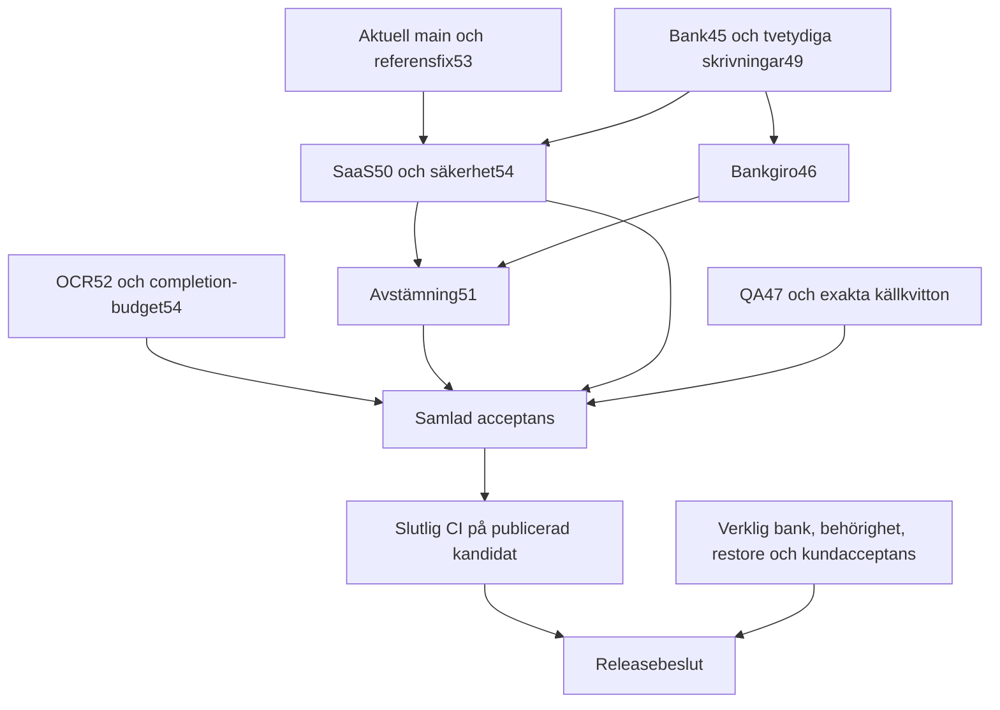

# Agent 9 — integrationsmatris och beroenden

Repository: `sharbel0022/Mgeorge`. Arbetsbranch: `feature/95-integration`, [samlad PR 49](https://github.com/sharbel0022/Mgeorge/pull/49). Startmain4ad205b; senare extern mainbf24a3c efter PR 48 ingår i kandidaten. Agent 9 har inte ändrat main eller driftsatt tjänsten.

## Leveransinventering

Sju producenter har levererat: Agent 1–5,7–8. Agent 6:s nya95-leverans har inte observerats vid omkontroll 19:33 UTC. Äldre onboardingarbete eller Agent 8:s browserfall räknas inte som en ny Agent 6-leverans. Samtliga tillgängliga PR-diffar har granskats efter funktion, säkerhet, kompatibilitet och ekonomisk dataintegritet. Korrigeringar har lagts på respektive producentbranch när en sådan finns.

| Agent | Område | Branch | PR | Integrerat fryst head | Granskning / grind |
| --- | --- | --- | --- | --- | --- |
| 1 | Bank | `feature/95-bank` | [45](https://github.com/sharbel0022/Mgeorge/pull/45) | `ac1abdc5469248eba212496af4a4573864908ace` | Teknisk granskning godkänd; [full CI](https://github.com/sharbel0022/Mgeorge/actions/runs/42085542333) och [security](https://github.com/sharbel0022/Mgeorge/actions/runs/42085542413) gröna |
| 2 | Bankgiro | `feature/95-bankgiro` | [46](https://github.com/sharbel0022/Mgeorge/pull/46) | `7d3bcb5ef533c39c9e23714e61709c924384ffb8` (endast dokument efter kod `732bfb3f`) | Kodens tekniska granskning godkänd; [full CI](https://github.com/sharbel0022/Mgeorge/actions/runs/42082127273) och [security](https://github.com/sharbel0022/Mgeorge/actions/runs/42082127269) gröna |
| 3 | OCR / fakturatolkning | `feature/95-ocr` | [52](https://github.com/sharbel0022/Mgeorge/pull/52) | `eb4242f783172ac441f9092f921b04b06dc11771` | Teknisk granskning godkänd; [full CI](https://github.com/sharbel0022/Mgeorge/actions/runs/42086208019) och [security](https://github.com/sharbel0022/Mgeorge/actions/runs/42086209181) gröna |
| 4 | SaaS / medgivanden | `feature/95-saas` | [50](https://github.com/sharbel0022/Mgeorge/pull/50) | `1619c0e3a63b922c75a7f46d493d39e68075952f` | Teknisk granskning godkänd; [full CI](https://github.com/sharbel0022/Mgeorge/actions/runs/42085643991) och [security](https://github.com/sharbel0022/Mgeorge/actions/runs/42085644255) gröna |
| 5 | Avstämning | `feature/95-reconciliation` | [51](https://github.com/sharbel0022/Mgeorge/pull/51) | `0954777f10da8be9fb15daf3878c539b51801142` | Teknisk granskning godkänd; [full CI](https://github.com/sharbel0022/Mgeorge/actions/runs/42081949245) och [security](https://github.com/sharbel0022/Mgeorge/actions/runs/42081949246) gröna |
| 7 | Säkerhet | `feature/95-security` | [54](https://github.com/sharbel0022/Mgeorge/pull/54) | `3db9f01305aa6830a4c2d1cc01970c06b91018c2` | Teknisk granskning godkänd; [full CI](https://github.com/sharbel0022/Mgeorge/actions/runs/42090903888) och [security](https://github.com/sharbel0022/Mgeorge/actions/runs/42090903867) gröna |
| 8 | QA / CI | `feature/95-quality` | [47](https://github.com/sharbel0022/Mgeorge/pull/47) | `875876ae539f5ecba1fc39d4c213197806e245ce` | Teknisk granskning godkänd; [full CI](https://github.com/sharbel0022/Mgeorge/actions/runs/42088065668) och [security](https://github.com/sharbel0022/Mgeorge/actions/runs/42088065637) gröna |
| 9 | Exakt referenssökning | `fix/95-decimal-reference` | [53](https://github.com/sharbel0022/Mgeorge/pull/53) | `d9ca037a90ef9c9e629f62c4dcbf9cfcdeacb459` | Teknisk granskning godkänd; [full CI](https://github.com/sharbel0022/Mgeorge/actions/runs/42082680240) och [security](https://github.com/sharbel0022/Mgeorge/actions/runs/42082680202) gröna |
| 6 | Ny UX-leverans | Ej observerad | Saknas | Saknas | NOT_DELIVERED — tydlig leveranslucka |
| 9 | Säkra tvetydiga medgivanden | `feature/95-integration` | [49](https://github.com/sharbel0022/Mgeorge/pull/49) | `9a531daf4eb09a36d9212d4a38e7eef7fa251b28` före sammanslagning | Egen ursprungsfix granskad,5730/5730; samlad slutgrind krävs |

**Slutkod fryst och publicerad:** `0ce2604de16b77bf96ff76ccedab115f61a3f9ac`, träd `50d1ec1226d7ced62bb640707740244c4504ab4c`. Senaste PR 47 och PR 54 ingår med godkända egna grindar. Den fulla kombinationsgrinden [42091716726](https://github.com/sharbel0022/Mgeorge/actions/runs/42091716726) och säkerhetsgrinden [42091716587](https://github.com/sharbel0022/Mgeorge/actions/runs/42091716587) är båda gröna på denna kod, med verifierad identisk checkout och källmanifest. Rapportkompletteringen ändrar endast dokument/evidens. PR46:s dokumentefterföljare7d3bcb5 maskerar privata betalningsidentifierare och bevarar exakt runtime/tester från732b; den ingår som ytterligare ancestor i rapportkandidaten. Den nya rapportkandidaten får egen fullCI.

## Faktisk integrationsordning

De första lokala mergecommittarna var53→46→51→47→50→45→54→52, följt av granskad QA-komplettering.53 förde in aktuell main48 och exakt referensrättning. Bank-/SaaS-syntesen bevarade root49:s återhämtningsmodell. OCR och ingress prövades tillsammans innan sista säkerhetsrättningen. Lokal samverkansgrind5414 är daterad före de sista kompletteringarna.

Alla kodförändringar bedömdes före integration; den samlade slut-CI:n körs på den publicerade PR 49-kandidaten. [Publiceringskvittot](evidence/publication-map.json) skiljer lokala merge-SHA från GitHubs skapade commit-SHA och kräver identiska Git-träd. Inget huvud har force-pushats eller skrivits över om producenten avancerat.

## Beroendegraf

Grafen beskriver funktionella beroenden, inte att alla delarna behöver mergas om i exakt samma topologiska ordning. Oberoende komponenter kunde granskas parallellt. Den kritiska slutgränsen är gemensam källa, verklig samverkan och separat extern acceptans.

## Överlapp och konflikthantering

| Yta | Berörda leveranser | Beslut och bevis |
| --- | --- | --- |
| Open Payments HTTP/provider och Node-server |45,49,50 | Både aktuella behörighetsfences och försiktig skrivåterhämtning bevaras. Bekräftat misslyckad skapning får säkert återförsök; känt/okänt möjligt medgivande får inte ersättas. DELETE räknas som ändring. |
| Node-server, sessionsgräns och loginbudget |45,50,54 | Företag/roll/status kontrolleras efter await och före commit. Additiv central limiterstart bevaras; rollbackbegränsningar dokumenteras. |
| Bankgirooriginal och avstämningsproveniens |46,51,54 | Generisk referens, formell OCR, manuell attest, originalintegritet och bank-/fakturarelation är separata bevis. Ingen dubbel ekonomi. |
| Workercompletion och requestbudget i olika filer |52,54 | Semantiskt fel trots konfliktfri Git-merge: byte kontra tecken. Verklig worker/route/lagring reproducerar felet;600 000-byte ingress bevarar befintliga domängränser. |
| SQLite-start och integrationstestprocesser |47,54 | Timeout före WAL, starka processassertions, additiv loginstate och krypterad restore. |
| Banktesternas modulladdning |45,54 sena kompletteringar | Producentens innehållsadresserade temporära cache med mode0600 används; alla 203 bankfall och assertions från integrationen är bytebevarade efter helpern. De 32 OCR-köfallen behålls och fyra nya tillkommer. 7/7 Node, 271/271 Sites samt typer är gröna på exakt slutträd. |
| Daterade resultat och poänghistorik |Alla producent-PR | `PROGRESS.md` och `QUALITY-SCORECARD.md` förenas additivt. Historiska resultat får inte tillskrivas slutkoden. |

[Maskinläsbar filöverlapp](evidence/producer-overlap.json) beräknas från varje PR:s egen merge-base med main, så att PR 51:s äldre bas inte felaktigt ser ut att återställa mainändringar. Filöverlapp kan inte upptäcka alla semantiska konflikter; OCR-budgeten är ett konkret exempel. [Granskningsloggen](REVIEW-LOG.md) beskriver alla reproducerade fel och producentkorrigeringar.

## Tidigare PR som redan ingår i main

Antalet filer är diffen från respektive mergecommits första förälder. Det är en
observerad historisk integrationsyta, inte en prognos för kommande PR. Fulla
filuppsättningar finns i `evidence/historical-overlap.json`.

| PR / funktion | Ursprunglig slutlig head-SHA | Merge-SHA i main | Filer | Aktuell kontroll |
| --- | --- | --- | ---: | --- |
| [40 — företagsgrund](https://github.com/sharbel0022/Mgeorge/pull/40) | `1d7dc21f0d61d98c239f51eb778facd79b6a6aed` | `f105e9cc5404d1bff3b4fe41e4e6af14d944d212` | 111 | Företag, roller, lagringsägare, callbackversioner och migrationer |
| [36 — Open Payments](https://github.com/sharbel0022/Mgeorge/pull/36) | `bbd19a5a891ae44d05af8c59aac5e4de21292ace` | `f75a293f367980cd360eca1886a2728db9c3e1f2` | 25 | Olöst svarstvetydighet reproducerad och rättad i kandidat |
| [39 — medgivande](https://github.com/sharbel0022/Mgeorge/pull/39) | `2eab8683db7e4ece1292b4c1f68c500af2f7e128` | `d6c2894c8cdb52669bf73bea64daac58701b182a` | 55 | State/session/aktör, krypterade handtag, replay, återkallelse |
| [41 — Bankgiro](https://github.com/sharbel0022/Mgeorge/pull/41) | `86730fe47aab8736c6cfb04d672c5e04a10d473d` | `7a535446a99f17a6f771dd8660fe2a99c6b84248` | 41 | Originalbytes, bankutfärdad relation, ingen dubbel ekonomi |
| [42 — synk/avstämning](https://github.com/sharbel0022/Mgeorge/pull/42) | `6e3895218c719ad01a9382b360624d693a7a841f` | `f1058371c4f68589d3f91748cf98a4ef3601e893` | 81 | Lease, kvot, aktuell behörighet, idempotent import och skrivfri förhandsvisning |
| [38 — onboarding](https://github.com/sharbel0022/Mgeorge/pull/38) | `a3b2b944428af5b4fbe31856e0f7076f3637405a` | `512aec368aa23898f352e9f1eabf786546d5969a` | 54 | Riktiga serverkontrakt, stale response-skydd, sanningsenliga bankfält |
| [37 — säkerhet](https://github.com/sharbel0022/Mgeorge/pull/37) | `3215d40b559b5cb60daf068fd197054e809e5f83` | `672c152242add9427c8526af8dd92431c526c8c2` | 27 | Företags-/rollacceptans, begränsade kroppar, loggar och testisolering |
| [43 — legacykompatibilitet](https://github.com/sharbel0022/Mgeorge/pull/43) | `ab941744c3ee38be7ecd4c3121b8e7496082b9ab` | `b2e7f4b23d26e9bf3aa84c6fdc21702562f3aa4f` | 7 | Valda konton, strikta company-gränser, kanonisk diagnostik |
| [44 — tidigare slutrapport](https://github.com/sharbel0022/Mgeorge/pull/44) | `ed88684964f1a8969d780c5aa94ec83ca95b9c34` | `4ad205b84d1852ec7ed33cabd70fdadbe2f9d5c5` | 21 | Endast dokument/evidens efter runtime-release b2e7 |

Färskt hämtade jobb- och loggresultat för main-körning
[42059325916](https://github.com/sharbel0022/Mgeorge/actions/runs/42059325916)
visar 1 899 Node + 3 756 Sites + 47 bridge = **5 702 godkända**, med noll fel,
skip, avbrutna eller TODO. Detta är basens CI, inte kandidatens CI.

GitHubs formella reviewlista har inga `APPROVED`-poster för PR 36–44. Vissa har
`COMMENTED`; separata historiska granskningsdokument finns. Dessa två slag av
bevis får inte beskrivas som samma sak. Agent 9 har inte mergat om dessa PR.

## Aktuell extern main och publicering

PR 48 mergades av annan aktör tillbf24a3c52ffc637d1e7bbc4d4f64a1732dcd9fee. Den innehåller bland annat sanningsenlig Gmail-/OCR-status, legacyåtervalidering, parser-/identitetsförbättringar och en fail-closed main-CI-trigger för moln-OCR. Agent 9 granskade överlappen och rättade decimalreferensfelet genom53. Mainmerge, Sites 63-publicering och det senare schemalagda OCR-jobbet tillskrivs inte Agent 9.

Kommersiell produktion är **NOT APPROVED** oavsett godkänd kodgranskning. Den nya kombinationen ska genom ordinarie PR-process, och extern acceptans får inte ersättas av syntetiska tester. [Releasegrindarna](RELEASE-GATES.md) är den normativa listan över öppna villkor.
