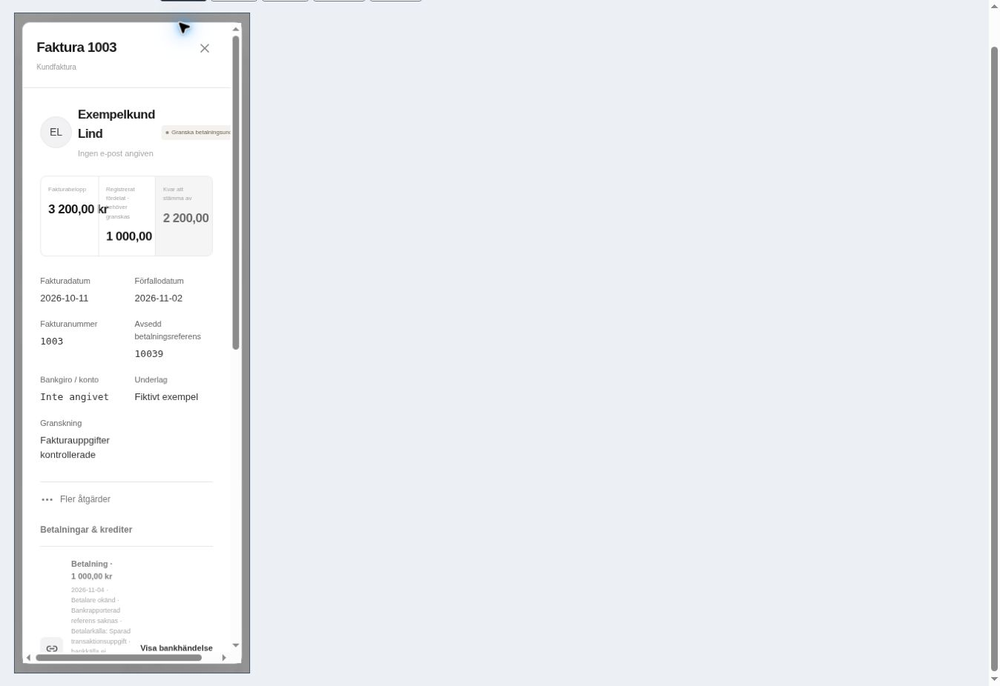
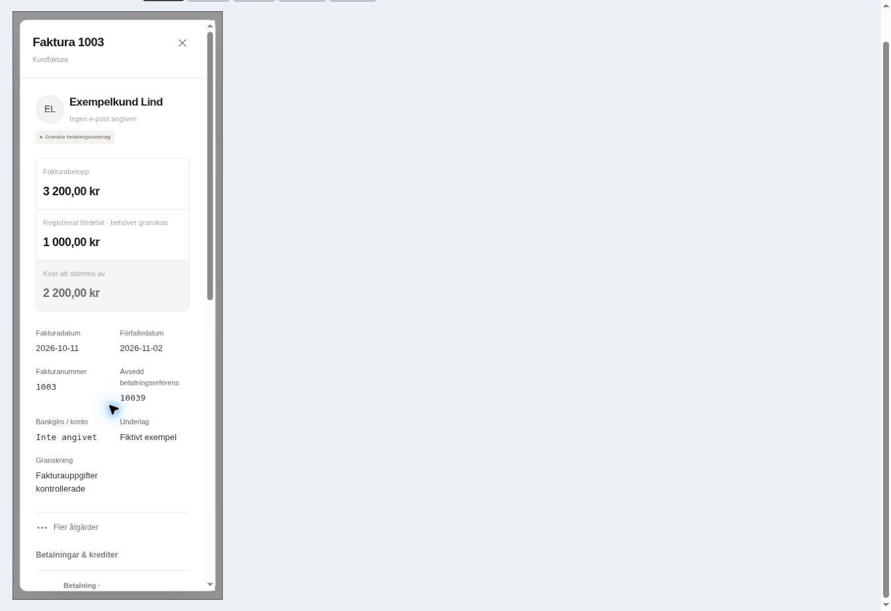
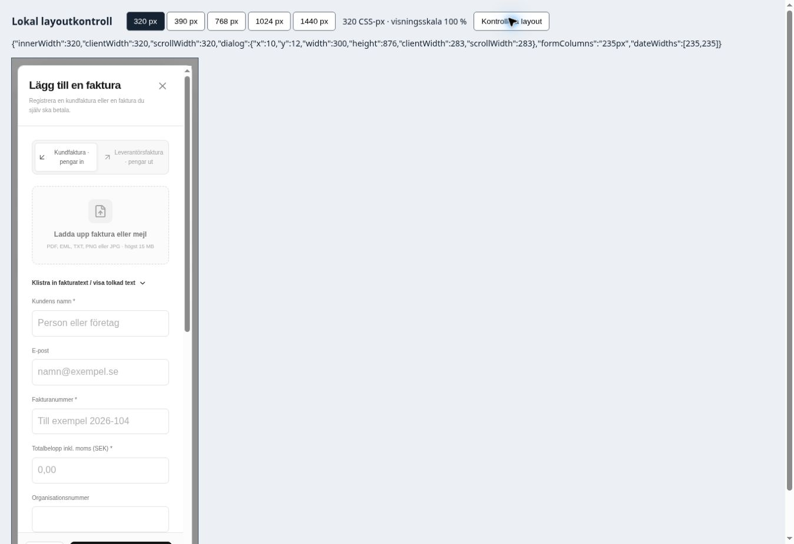
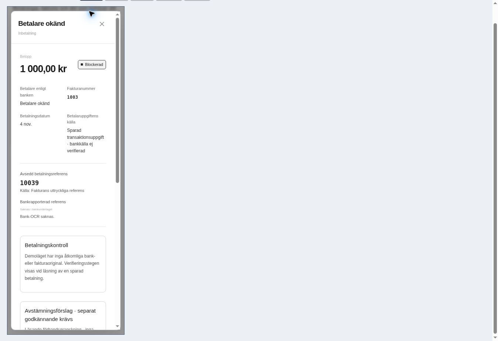
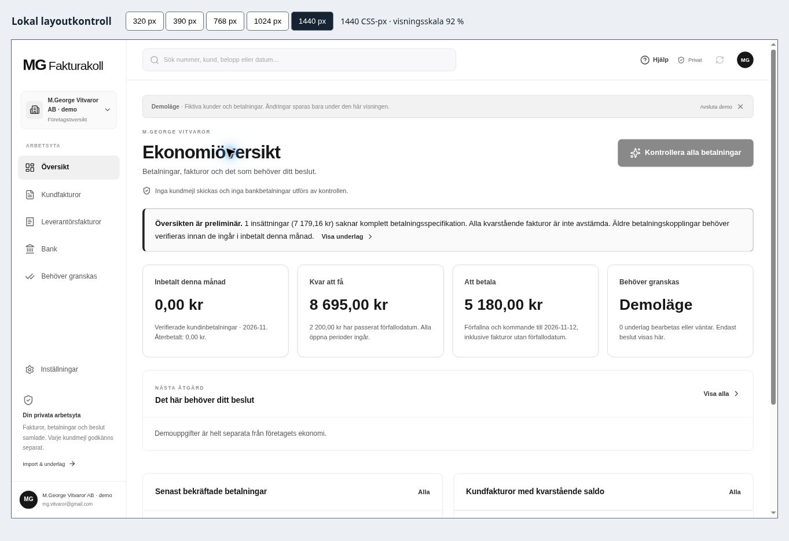

# Lokal visuell kontroll – andra kvalitetsleveransen

2026-11-05. Fryst produktionskälla: `571073b8172ab53899a4ce3c2b717c7fe24daee2`. Den riktiga Sites-applikationen kördes genom den hanterade lokala förhandsvisningen och dess inbyggda demodata. Webbläsaren styrdes genom CUA. Inga fakturor sparades, kopplingar godkändes, bankanrop startades eller mejl skickades i denna kontroll.

## Resultat och omfattning

**25/25 uppmätta layoutfall passerar**, fem huvudvyer vid fem verkliga CSS-vybredder. Därutöver finns tre avgränsade interaktionsobservationer: kombinerad sökning och återställt fokus, avbrutet tomt formulär samt korrekt ordval för historiska bankkopplingar. De är inte ytterligare backendtester.

| Vy | 320 | 390 | 768 | 1024 | 1440 |
|---|---|---|---|---|---|
| Ekonomiöversikt | Godkänd | Godkänd | Godkänd | Godkänd | Godkänd |
| Kundfakturalista | Godkänd | Godkänd | Godkänd | Godkänd | Godkänd |
| Fakturadialog | Godkänd efter rättning | Godkänd | Godkänd | Godkänd | Godkänd |
| Bankdialog | Godkänd | Godkänd | Godkänd | Godkänd | Godkänd |
| Fakturaformulär | Godkänd efter rättning | Godkänd efter rättning | Godkänd | Godkänd | Godkänd |

Den tillfälliga [testvyn](../../../scripts/quality8/responsive-preview.html) sätter bredden på en same-origin iframe som laddar den oförändrade applikationen. `innerWidth` kontrollerades mot varje avsedd bredd. Vyns höjd var 900 px. En bred iframe skalades endast visuellt för att få plats på skärmen; dess uppmätta CSS-viewport var fortfarande 1440 px. Scrollbarens bredd förklarar exempelvis `innerWidth:320` och `clientWidth:305` i en vanlig sida. Dialogerna jämförs också separat mot sin egen `clientWidth`. Avsiktlig rullning i en lokal navigeringsrad räknas inte som sidöverflöde.

[Mätkvitto](final-observations.json) innehåller exakta källträd, uppmätta dimensioner, bildhashar och avgränsningar. Den aktuella tabellen använder senaste observationen för varje vy/bredd. [Före-rättning](observations-before-css-fix.json) bevarar även den negativa observationen; tidigare och senare observationer adderas inte till ett större antal unika godkännanden.

## Upptäckta och rättade brister

Vid 320 px hade fakturadialogen `clientWidth:283` men `scrollWidth:309`. Den långa statusetiketten sträckte sig utanför dialogen och de tre beloppskolumnerna trängdes. `da0e393` låter etiketten radbrytas och staplar beloppen vid högst 480 px. Efter rättning är båda bredderna **283 px**, med hela belopp synliga. Större vyer behåller sin befintliga kolumnindelning.

Fakturaformulärets smala datumfält fick samma avgränsade mobilanpassning i `300509e`: en formulärkolumn vid högst 480 px. De verkliga datumfälten är nu **235 px vid 320** och **305 px vid 390**. Vid 768/1024/1440 återstår två kolumner. Formuläret stängdes utan att spara, och fokus återgick till **Ny faktura**.

Bankdialogen visade redan att betalare och bankreferens saknades och att betalningen var blockerad. Rubriken för gamla bokade allokeringar ändrades samtidigt från ”Bekräftade matchningar” till **”Registrerade kopplingar”**, i både Node och Sites. Det ändrar ingen ekonomisk uppgift. Den nya Sites-rubriken verifierades i [åtkomstträdet](bank-label-accessibility.txt). Oberoende källgranskning av båda små rättningarna fann inga kvarstående fynd; inga tester som enbart speglar CSS skrevs.

Den kombinerade sökningen `1003 3 200,00 11/10/2026` gav en träff på faktura 1003. När dialogen stängdes med Escape var sökningen tom och fokus låg på **Sök i arbetsytan**. Den korrigerade översikten räknade inte de gamla demokopplingarna som bankverifierad inbetalning och förklarade varför underlaget var preliminärt.

## Bilder

| Före mobilrättning | Efter mobilrättning |
|---|---|
|  |  |

## Begränsningar och tekniska avbrott

Detta är en lokal kontroll med syntetiska demodata, inte en autentiserad produktionsresa, fysisk mobiltestning eller skärmläsaracceptans. Den manuella flerfakturakomponenten visar demospärren; en verklig fördelning utfördes inte. Dess API-/klient-/interaktionsbevis finns i den separata manuella fördelningsrapporten.

En mellanliggande webbläsarkontroll avbröts av en renderer-krasch med felkod 9. Orsaken är inte fastställd. Befintliga observationer sparades, samma lokala sida laddades om och de återstående formulärmätningarna lästes genom testvyns synliga, läsande mätknapp. Inga säkerhets- eller nätverksgränser ändrades. En misslyckad helsidesskärmbild och ett avbrutet extra Tab-cykelprov räknas inte som godkända. Första bildbatchens fördröjda skärmuppdateringar används inte som nya mått eller som de här utvalda bilderna.

Testvyn kopieras till `sites/public/__quality8-responsive.html` enbart under lokal QA och tas bort före publicering. Den ingår inte i den publicerade applikationen.
