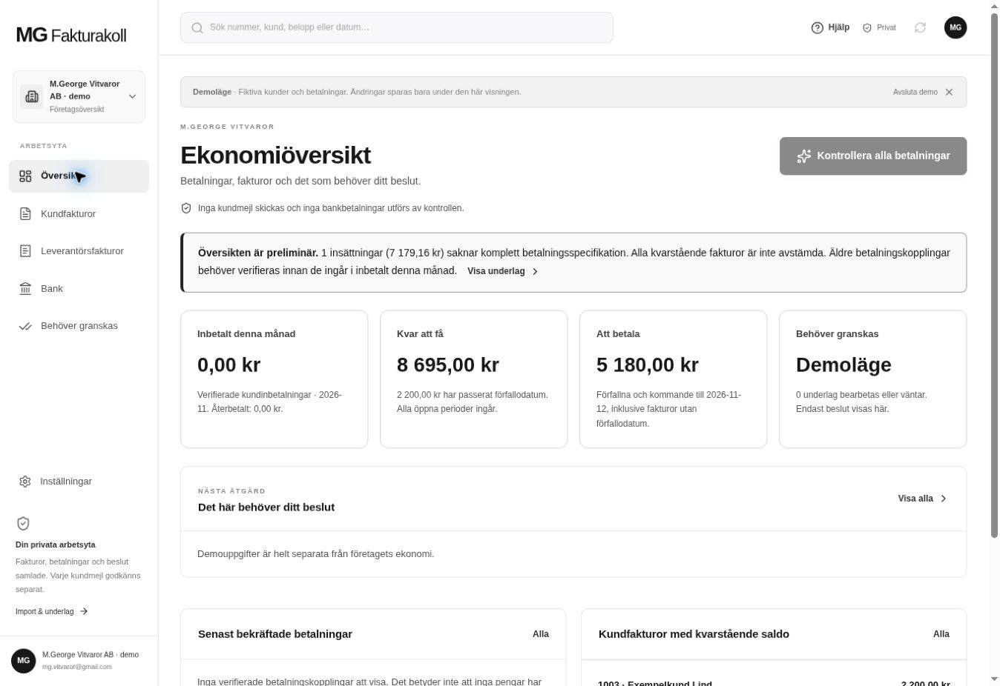
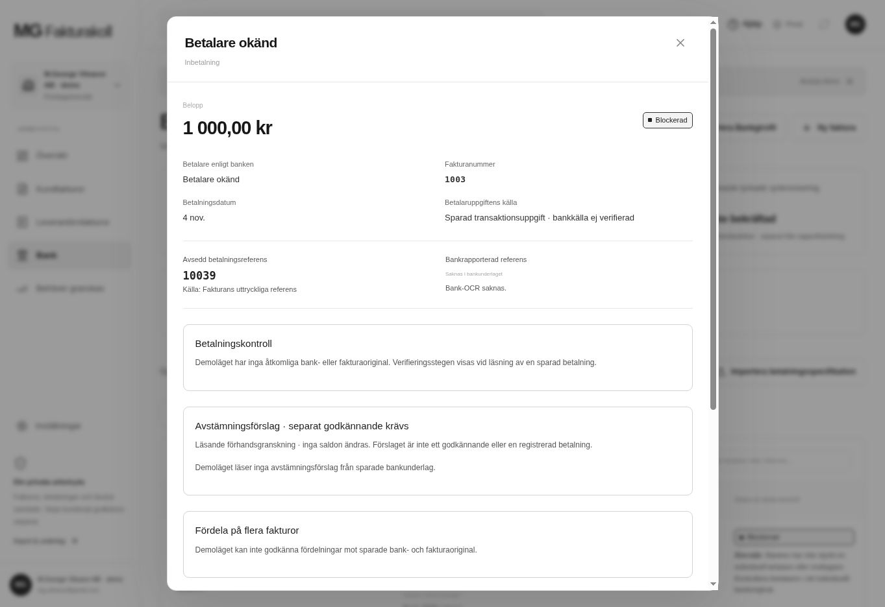

# Publicerad UI-efterkontroll: Site 64

Exakt main `819adee2f3848b474167eb6b15f82584caeb39af`, Sites-träd `6e024c917ba8833e516db5723f8be1ff1d1bc4dc`. Cloud Chrome kontrollerades efter lyckad publicering den 5 november 2026, cirka 22:56–22:57 UTC.

[Maskinläsbara observationer](observations.json) innehåller den avgränsade UI-resan. Den utloggade vyn höll ekonomin okänd. Det uttryckliga demoläget visade preliminär översikt, bevarade registrerade saldon och noll verifierade inbetalningar när bankbevis saknades. Sökning→piltangent→Enter→Escape återställde fokus till sökfältet. Bankdialogen visade okänd betalare, saknad bankreferens, separat avsedd fakturareferens, registrerade kopplingar och ingången för explicit fördelning på flera fakturor.

Skärmbilderna är oförändrade browserbytes. Textfilerna är efterföljande oförändrat-/diffkvitton, inte kompletta AX-exporter; de fulla synliga träden observerades i verktygsprotokollet. Demot avslutades och den privata utloggade vyn återställdes. Ingen bankbetalning, kundallokering eller kundsändning utfördes. Detta är inte en autentiserad produktionsresa, fysisk mobilkontroll eller ny 25-fallsbreddsmatris.
